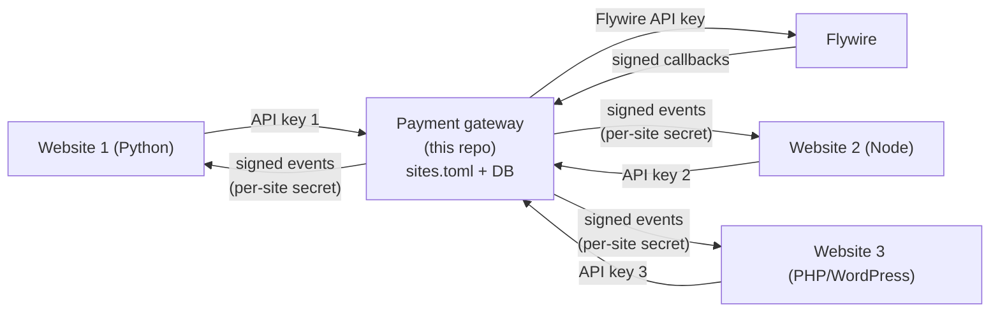
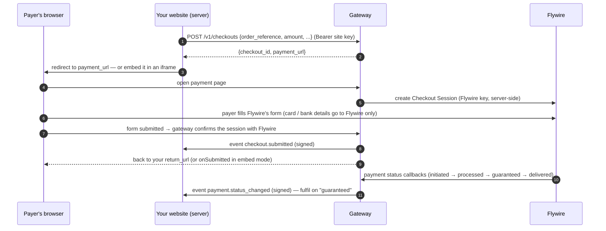

# Integrating websites with the Flywire Payment Gateway

This repository runs **one payment gateway** that talks to Flywire on behalf of **any number of websites**.
A website never handles Flywire credentials, card data or Flywire's API. It makes a few HTTPS calls to the
gateway and receives signed events back. This works from any language: Python, Node.js, PHP, WordPress
or anything else that can send HTTP requests.

**Adding a website is a change in one place:** a new block in [`sites.toml`](../sites.toml) plus two keys in
the gateway's environment.

---

## Contents

1. [How it works](#1-how-it-works)
2. [Deploy the gateway (once)](#2-deploy-the-gateway-once)
3. [Add a website (per site, 5 minutes)](#3-add-a-website-per-site-5-minutes)
4. [Integrate the website (per site)](#4-integrate-the-website-per-site)
   - [Python: Django / Flask / FastAPI](#python-django--flask--fastapi)
   - [JavaScript: Node / Express / Next.js](#javascript-node--express--nextjs)
   - [PHP: plain PHP / Laravel / WordPress](#php-plain-php--laravel--wordpress)
5. [API reference](#5-api-reference)
6. [Events (webhooks to your site)](#6-events-webhooks-to-your-site)
7. [Statuses and when to fulfil an order](#7-statuses-and-when-to-fulfil-an-order)
8. [Testing in the sandbox](#8-testing-in-the-sandbox)
9. [Going live](#9-going-live)
10. [Security model](#10-security-model)
11. [Troubleshooting](#11-troubleshooting)

---

## 1. How it works





Key ideas:

- **Your server decides the amount.** The browser never sends prices to the gateway.
- **"Submitted" is not "paid".** Money is confirmed later by `payment.status_changed` events.
- **The payment link is single-purpose.** It only lets the holder pay that one checkout. It is safe to email.

---

## 2. Deploy the gateway (once)

### 2.1 Configuration

All secrets live in environment variables. Copy `.env.example` to `.env` (git-ignored) for local use, or
set the variables in your hosting platform.

| Variable | Example | Purpose |
|---|---|---|
| `FLYWIRE_ENVIRONMENT` | `sandbox` / `production` | Selects Flywire's API, SDK and the matching credentials |
| `FLYWIRE_SANDBOX_API_KEY` / `FLYWIRE_PRODUCTION_API_KEY` | from Flywire | Flywire API key |
| `FLYWIRE_SANDBOX_SHARED_SECRET` / `…PRODUCTION…` | from Flywire | Verifies Flywire callbacks |
| `FLYWIRE_SANDBOX_FRONTEND_KEY` / `…PRODUCTION…` | from Flywire | Browser SDK key |
| `FLYWIRE_SANDBOX_RECIPIENT_ID` / `…PRODUCTION…` | `D0226` | Default Flywire portal (sites can override) |
| `GATEWAY_PUBLIC_URL` | `https://payments.example.ac.uk` | Public HTTPS address of the gateway |
| `GATEWAY_SECRET` | 43 random chars | Signs payment links. Changing it invalidates outstanding links |
| `GATEWAY_SITES_FILE` | `sites.toml` | Site registry |
| `GATEWAY_DB_PATH` | `/data/gateway.db` | SQLite database (persist this!) |
| `GATEWAY_CHECKOUT_TTL_HOURS` | `24` | How long a payment link stays valid |
| `SITE_<NAME>_API_KEY`, `SITE_<NAME>_WEBHOOK_SECRET` | 43 random chars | Per-site keys (names set in `sites.toml`) |

Generate every key/secret with:

```bash
python -m flywire_checkout.gateway new-key
```

### 2.2 Run it

**Docker (recommended):**

```bash
docker build -t flywire-gateway .
docker run -d --name flywire-gateway --restart unless-stopped \
  --env-file /secure/path/gateway.env \
  -v flywire-gateway-data:/data \
  -p 127.0.0.1:8080:8080 \
  flywire-gateway
```

The image runs as a non-root user, contains no secrets, persists data in `/data`, and has a health check
(`GET /healthz`).

**Without Docker:**

```bash
pip install ".[gateway]"
python -m flywire_checkout.gateway check-config     # validates everything, prints the sites
python -m flywire_checkout.gateway serve --host 127.0.0.1 --port 8080
```

### 2.3 Put it behind HTTPS

Run the gateway behind your usual reverse proxy (nginx, Apache, a load balancer) with TLS, and set
`GATEWAY_PUBLIC_URL` to that HTTPS address. Payment pages must be served over HTTPS in production.
The gateway only sends Flywire a callback URL (`<GATEWAY_PUBLIC_URL>/webhooks/flywire`) when the public
URL is HTTPS.

Minimal nginx example:

```nginx
server {
    server_name payments.example.ac.uk;
    listen 443 ssl http2;
    # ssl_certificate ...; ssl_certificate_key ...;
    client_max_body_size 256k;
    location / {
        proxy_pass http://127.0.0.1:8080;
        proxy_set_header Host $host;
        proxy_set_header X-Forwarded-For $proxy_add_x_forwarded_for;
        proxy_set_header X-Forwarded-Proto $scheme;
    }
}
```

### 2.4 Operations

- **Back up `GATEWAY_DB_PATH`.** It records which checkout belongs to which site and order.
- **Run one instance with SQLite.** To run several instances behind a load balancer, implement the
  `GatewayStore` protocol (`src/flywire_checkout/gateway/store.py`) on PostgreSQL. Every state change is
  a single conditional `UPDATE`/`INSERT`.
- **Logs never contain** API keys, secrets, card data or payment-link tokens (they are redacted).
- **Flywire allows 500 API requests per minute per IP.** Exceeding it blocks the IP for 10 minutes.

---

## 3. Add a website (per site, 5 minutes)

All changes happen in this repo / the gateway's environment. Nothing changes in the other websites.

**Step 1. Add a block to [`sites.toml`](../sites.toml).**

```toml
[sites.website-2]                       # id: lowercase letters, digits, hyphens
name = "Website 2"                      # shown on the payment page
origins = ["https://web2.example.ac.uk"]               # pages allowed to embed the payment page
return_url = "https://web2.example.ac.uk/payment/return"
cancel_url = "https://web2.example.ac.uk/basket"       # optional, defaults to return_url
webhook_url = "https://web2.example.ac.uk/api/payment-events"   # optional but recommended
api_key_env = "SITE_WEBSITE_2_API_KEY"
webhook_secret_env = "SITE_WEBSITE_2_WEBHOOK_SECRET"   # required if webhook_url is set
recipient_id = "D0226"                  # Flywire portal; omit to use the default
required_fields = ["student_first_name", "student_last_name", "student_email"]
session_types = ["one_off"]             # "one_off" and/or "recurring" (Flywire-hosted plans)
max_amount = 1000000                    # optional cap in subunits (here £10,000.00)
locale = "en"                           # Flywire form language
```

`required_fields` must match the Flywire portal's required fields. Flywire's API lists them at
`GET /recipients/{id}`, and your Flywire implementation manager can confirm them. For portal `D0226` they
are `student_first_name`, `student_last_name` and `student_email`.

**Step 2. Create the site's two secrets** in the gateway environment:

```bash
SITE_WEBSITE_2_API_KEY=$(python -m flywire_checkout.gateway new-key)
SITE_WEBSITE_2_WEBHOOK_SECRET=$(python -m flywire_checkout.gateway new-key)
```

**Step 3. Validate and restart:**

```bash
python -m flywire_checkout.gateway check-config
# then restart the gateway (e.g. docker restart flywire-gateway, after rebuilding if sites.toml changed)
```

**Step 4. Hand over to the website team** through a secure channel:

| Give them | Value |
|---|---|
| `PAYMENT_GATEWAY_URL` | your `GATEWAY_PUBLIC_URL` |
| `PAYMENT_GATEWAY_API_KEY` | value of `SITE_WEBSITE_2_API_KEY` |
| `PAYMENT_GATEWAY_WEBHOOK_SECRET` | value of `SITE_WEBSITE_2_WEBHOOK_SECRET` |
| Client file | one of [`clients/`](../clients) for their language |

Each website gets its **own** API key. A key only works for its own site's checkouts.

---

## 4. Integrate the website (per site)

Every website does the same three things, whatever its language:

1. **Create a checkout server-side** when the payer clicks "Pay". Send your own order id and the amount.
2. **Send the payer to the payment page**, either:
   - **Redirect:** send the browser to `payment_url`. The payer comes back to your `return_url`.
   - **Embed:** show the payment page inside your page with `embed.js`. Your page must be listed in
     `origins`.
3. **Learn the outcome:**
   - **Events:** receive signed `payment.status_changed` events at your `webhook_url`.
   - **Polling:** call `GET /v1/checkouts/{id}`.
   - **Fulfil the order** when `payment_status` becomes `guaranteed` (see [§7](#7-statuses-and-when-to-fulfil-an-order)).

Ready-made, dependency-free clients:

| Language | File | Requires |
|---|---|---|
| Python | [`clients/python/flywire_gateway_client.py`](../clients/python/flywire_gateway_client.py) | Python 3.9+, standard library only |
| Node.js | [`clients/node/flywire-gateway.mjs`](../clients/node/flywire-gateway.mjs) | Node 18+ |
| PHP | [`clients/php/FlywireGateway.php`](../clients/php/FlywireGateway.php) | PHP 7.4+ with curl |

A complete working example site (Node, both redirect and embed) is in
[`examples/node-site/server.mjs`](../examples/node-site/server.mjs).

> **Amounts are in the smallest currency unit of the Flywire portal's currency.** Portal `D0226` bills in
> GBP, so `12500` means £125.00.

### Python: Django / Flask / FastAPI

Copy `clients/python/flywire_gateway_client.py` into your project.

```python
# payments.py
import os
from flywire_gateway_client import GatewayClient, GatewayError, verify_webhook

gateway = GatewayClient(os.environ["PAYMENT_GATEWAY_URL"], os.environ["PAYMENT_GATEWAY_API_KEY"])
WEBHOOK_SECRET = os.environ["PAYMENT_GATEWAY_WEBHOOK_SECRET"]

def start_payment(order, student):
    checkout = gateway.create_checkout(
        order_reference=order.reference,           # your id; repeating it returns the same checkout
        amount=order.amount_pence,                 # from YOUR database, never from the browser
        description=f"Course fee {order.reference}",
        recipient_fields={
            "student_first_name": student.first_name,
            "student_last_name": student.last_name,
            "student_email": student.email,
        },
        payer={"email": student.email, "country": "GB"},   # optional pre-fill
        metadata={"student_id": str(student.id)},          # optional, echoed back in events
    )
    order.checkout_id = checkout["checkout_id"]
    order.save()
    return checkout["payment_url"]
```

**Django views:**

```python
from django.http import HttpResponse, HttpResponseBadRequest
from django.shortcuts import redirect
from django.views.decorators.csrf import csrf_exempt
from django.views.decorators.http import require_POST
import json

def pay(request, order_id):
    order = Order.objects.get(pk=order_id, user=request.user)
    return redirect(start_payment(order, request.user.student))

def payment_return(request):
    # Never trust query parameters — ask the gateway.
    checkout = gateway.get_checkout(request.GET["checkout_id"])
    return render(request, "payment_return.html", {"checkout": checkout})

@csrf_exempt            # authenticated by signature instead
@require_POST
def payment_events(request):
    if not verify_webhook(WEBHOOK_SECRET, request.headers.get("X-Gateway-Signature"), request.body):
        return HttpResponseBadRequest("bad signature")
    event = json.loads(request.body)
    handle_event(event)  # see "Handling events" below; must be idempotent on event["id"]
    return HttpResponse("ok")
```

**Flask:**

```python
@app.post("/payment/events")
def payment_events():
    raw = request.get_data()                       # raw bytes, before any JSON parsing
    if not verify_webhook(WEBHOOK_SECRET, request.headers.get("X-Gateway-Signature"), raw):
        abort(400)
    handle_event(json.loads(raw))
    return "ok"
```

**FastAPI:** use `raw = await request.body()` the same way.

### JavaScript: Node / Express / Next.js

Copy `clients/node/flywire-gateway.mjs` into your project.

```js
import express from "express";
import { GatewayClient, verifyWebhook } from "./flywire-gateway.mjs";

const gateway = new GatewayClient(process.env.PAYMENT_GATEWAY_URL, process.env.PAYMENT_GATEWAY_API_KEY);
const app = express();

app.post("/orders/:id/pay", requireLogin, async (req, res) => {
  const order = await db.orders.findForUser(req.params.id, req.user.id);
  const checkout = await gateway.createCheckout({
    orderReference: order.reference,
    amount: order.amountPence,
    description: `Course fee ${order.reference}`,
    recipientFields: {
      student_first_name: req.user.firstName,
      student_last_name: req.user.lastName,
      student_email: req.user.email,
    },
  });
  await db.orders.setCheckout(order.id, checkout.checkout_id);
  res.redirect(303, checkout.payment_url);
});

app.get("/payment/return", async (req, res) => {
  const checkout = await gateway.getCheckout(String(req.query.checkout_id));   // verify server-side
  res.render("payment-return", { checkout });
});

// Raw body is required for signature verification.
app.post("/payment/events", express.raw({ type: "application/json" }), async (req, res) => {
  if (!verifyWebhook(process.env.PAYMENT_GATEWAY_WEBHOOK_SECRET, req.get("X-Gateway-Signature"), req.body)) {
    return res.sendStatus(400);
  }
  await handleEvent(JSON.parse(req.body.toString("utf8")));
  res.sendStatus(200);
});
```

**Next.js (App Router) webhook:**

```js
// app/api/payment-events/route.js
import { verifyWebhook } from "@/lib/flywire-gateway.mjs";
export async function POST(request) {
  const raw = Buffer.from(await request.arrayBuffer());
  if (!verifyWebhook(process.env.PAYMENT_GATEWAY_WEBHOOK_SECRET, request.headers.get("x-gateway-signature"), raw)) {
    return new Response("bad signature", { status: 400 });
  }
  await handleEvent(JSON.parse(raw.toString("utf8")));
  return new Response("ok");
}
```

Call `createCheckout` from a server action or route handler, never from client components.

### PHP: plain PHP / Laravel / WordPress

Copy `clients/php/FlywireGateway.php` into your project.

```php
require_once __DIR__ . '/FlywireGateway.php';

$gateway = new FlywireGateway\Client(getenv('PAYMENT_GATEWAY_URL'), getenv('PAYMENT_GATEWAY_API_KEY'));

// pay.php — after loading $order for the logged-in user
$checkout = $gateway->createCheckout($order['reference'], (int) $order['amount_pence'], [
    'description'      => 'Course fee ' . $order['reference'],
    'recipient_fields' => [
        'student_first_name' => $student['first_name'],
        'student_last_name'  => $student['last_name'],
        'student_email'      => $student['email'],
    ],
]);
save_checkout_id($order['id'], $checkout['checkout_id']);
header('Location: ' . $checkout['payment_url'], true, 303);
exit;
```

```php
// payment-events.php — webhook endpoint
require_once __DIR__ . '/FlywireGateway.php';
$raw = file_get_contents('php://input');
if (!FlywireGateway\verify_webhook(getenv('PAYMENT_GATEWAY_WEBHOOK_SECRET'),
                                   $_SERVER['HTTP_X_GATEWAY_SIGNATURE'] ?? null, $raw)) {
    http_response_code(400);
    exit('bad signature');
}
handle_event(json_decode($raw, true));
echo 'ok';
```

**Laravel:** put the calls in a controller. Exclude the webhook route from CSRF
(`VerifyCsrfToken::$except`) and read the body with `$request->getContent()`.

**WordPress:** register the webhook with the REST API and read the raw body:

```php
add_action('rest_api_init', function () {
    register_rest_route('payments/v1', '/events', [
        'methods'  => 'POST',
        'permission_callback' => '__return_true',   // authenticated by signature below
        'callback' => function (WP_REST_Request $request) {
            $raw = $request->get_body();
            if (!FlywireGateway\verify_webhook(PAYMENT_GATEWAY_WEBHOOK_SECRET,
                                               $request->get_header('x-gateway-signature'), $raw)) {
                return new WP_REST_Response('bad signature', 400);
            }
            handle_event(json_decode($raw, true));
            return new WP_REST_Response('ok', 200);
        },
    ]);
});
// webhook_url in sites.toml: https://your-site/wp-json/payments/v1/events
```

Define `PAYMENT_GATEWAY_*` in `wp-config.php` or the server environment, never in the database or theme.

### Embedding instead of redirecting (any language)

Your server creates the checkout exactly as above, then renders:

```html
<div id="payment"></div>
<script src="https://payments.example.ac.uk/static/embed.js"></script>
<script>
  FlywireGateway.mount("#payment", "<?= htmlspecialchars($checkout['payment_url']) ?>", {
    onSubmitted: (e) => { window.location = "/orders/123/thank-you"; },   // form submitted (not yet paid)
    onError:     (e) => { console.warn("payment error", e.message); },
    onCancel:    ()  => { window.location = "/basket"; },
    minHeight: 640,
  });
</script>
```

- The page embedding it must be listed in the site's `origins`. Browsers refuse to embed it anywhere else.
- The iframe resizes itself automatically.
- If your site sets a Content-Security-Policy, add the gateway's origin to `script-src` and `frame-src`.

### Handling events (all languages)

```text
handle_event(event):
    if event.id already processed: return            # events can be delivered more than once
    record event.id
    order = find order by event.data.order_reference
    if event.type == "payment.status_changed":
        if event.data.payment_status_at < order.last_status_at: return   # out-of-order delivery
        order.payment_status = event.data.payment_status
        if event.data.payment_status == "guaranteed": fulfil(order)
        if event.data.payment_status in ("failed", "cancelled", "reversed"): flag(order)
```

Respond `2xx` quickly and do slow work in the background.

---

## 5. API reference

Base URL: `GATEWAY_PUBLIC_URL`. All site calls are **server-to-server** with
`Authorization: Bearer <site API key>` and JSON bodies.

### `POST /v1/checkouts`: create a checkout

| Field | Type | Required | Notes |
|---|---|---|---|
| `order_reference` | string | yes | Your order id, 1–64 chars `A-Z a-z 0-9 . _ : -`. **Idempotent:** the same value returns the same checkout |
| `amount` | integer | yes | Smallest currency unit of the portal currency (`12500` = £125.00). Must be > 0 and ≤ `max_amount` |
| `session_type` | string | no | `one_off` (default) or `recurring`, if enabled for the site |
| `description` | string | no | ≤ 200 chars, shown on the payment page |
| `recipient_fields` | object | depends | Portal fields, e.g. `{"student_email": "…"}`. All `required_fields` must be present |
| `payer` | object | no | Pre-fill: `id`, `first_name`, `last_name`, `email`, `phone`, `address`, `city`, `zip`, `country` (ISO-2, uppercase), `state` |
| `metadata` | object | no | Up to 20 string pairs echoed back in responses and events |

Response `201 Created` (or `200 OK` if the order_reference already existed):

```json
{
  "checkout_id": "chk_dSFdm7e90gocBsf6xkElk2bp",
  "order_reference": "INV-1001",
  "status": "created",
  "amount": 12500,
  "session_type": "one_off",
  "payment_reference": null,
  "payment_status": null,
  "payment_status_at": null,
  "metadata": {"student_id": "42"},
  "expires_at": "2026-10-21T15:20:49+00:00",
  "created_at": "2026-10-20T15:20:49+00:00",
  "updated_at": "2026-10-20T15:20:49+00:00",
  "payment_url": "https://payments.example.ac.uk/pay/chk_dSFdm7e90gocBsf6xkElk2bp/kyoO…"
}
```

Repeating an `order_reference` with a **different amount or session_type** returns `409 conflict`. Use a
new order reference for a changed order.

### `GET /v1/checkouts/{checkout_id}`: status

Returns the same object. Sites can only read their own checkouts; any other id returns `404`.

### `POST /v1/checkouts/{checkout_id}/cancel`: cancel

Cancels a checkout the payer hasn't submitted yet, and expires the Flywire session. Cancelling twice is
fine. It returns `409` if the payer has already submitted.

### Errors

Every error has the same shape:

```json
{"error": {"code": "invalid_request", "message": "recipient_fields missing required values: student_email",
           "details": [{"field": "amount", "message": "Input should be greater than 0"}]}}
```

| HTTP | `code` | Meaning |
|---|---|---|
| 401 | `unauthorized` | Missing/wrong site API key |
| 404 | `not_found` | Unknown checkout (or another site's) |
| 409 | `conflict` | Order reference reused with different values; or already submitted |
| 410 | `gone` | (payment page) link cancelled or expired |
| 422 | `invalid_request` | Validation failed. `details` lists the fields |
| 502 | `payment_provider_error` | Flywire rejected or failed the request. The detail is in the gateway logs |

### Payment page (browser)

`payment_url` points to `GET /pay/{checkout_id}/{token}`. Send the payer there, or embed it. After the
payer submits, the page redirects to:

```
<return_url>?checkout_id=chk_…&order_reference=INV-1001
```

**Treat these query parameters as untrusted.** Call `GET /v1/checkouts/{checkout_id}` to get the real
status. "Return to site" links go to `cancel_url` with the same parameters.

Payment links stay valid for `GATEWAY_CHECKOUT_TTL_HOURS` (default 24 h). Flywire's own 30-minute session
is renewed automatically while the link is valid.

---

## 6. Events (webhooks to your site)

The gateway POSTs JSON to the site's `webhook_url`:

```http
POST /payment/events
Content-Type: application/json
X-Gateway-Event-Id: evt_9c1f0e4b2a7d4e1f8a3b5c6d
X-Gateway-Signature: t=1760972400,v1=5f2a…(hex)
```

```json
{
  "id": "evt_9c1f0e4b2a7d4e1f8a3b5c6d",
  "type": "payment.status_changed",
  "created_at": "2026-10-20T15:21:07+00:00",
  "site_id": "website-2",
  "data": {
    "checkout_id": "chk_dSFdm7e90gocBsf6xkElk2bp",
    "order_reference": "INV-1001",
    "status": "confirmed",
    "amount": 12500,
    "payment_reference": "DUN123456789",
    "payment_status": "guaranteed",
    "payment_status_at": "2026-10-20T15:21:05+00:00",
    "metadata": {"student_id": "42"},
    "flywire_event": {
      "type": "guaranteed", "date": "2026-10-20T15:21:05+00:00", "status": "guaranteed",
      "amount_from": "12500", "currency_from": "GBP", "amount_to": "12500", "currency_to": "GBP",
      "payment_method": "card", "cancellation_reason": null
    }
  }
}
```

| `type` | When | Delivery |
|---|---|---|
| `checkout.submitted` | Payer submitted the form and the gateway confirmed it with Flywire. **Not yet paid.** | Best effort, one attempt. Poll if you rely on it |
| `payment.status_changed` | Flywire reported a payment status (`initiated`, `processed`, `guaranteed`, `delivered`, `failed`, `cancelled`, `reversed`) | Retried. If your endpoint isn't `2xx`, the gateway tells Flywire to resend, up to 5 more times |

**Verifying the signature (any language):**

1. Split the header into `t` (unix seconds) and `v1` (hex).
2. Reject if `|now − t| > 300` seconds.
3. Compute `HMAC-SHA256(key = webhook secret, message = t + "." + raw request body)` as lowercase hex.
4. Compare it with `v1` in constant time.

The clients in `clients/` implement exactly this. Always verify over the **raw** bytes, before parsing the
JSON.

**Your endpoint must:**
- reply `2xx` within 10 seconds;
- treat repeated `id`s as already handled;
- cope with out-of-order delivery (compare `payment_status_at`).

---

## 7. Statuses and when to fulfil an order

**Checkout `status`** (the gateway's view of the payment link):

| Status | Meaning |
|---|---|
| `created` | Checkout exists; payer hasn't opened the link yet |
| `open` | Payer opened it; Flywire form is live |
| `confirming` | Submission being confirmed with Flywire (seconds) |
| `confirmed` | Payer submitted; await `payment_status` |
| `errored` | Confirmation failed; the payer can retry from the same link |
| `cancelled` | Cancelled by your site |
| `expired` | Link lifetime passed without submission |

**`payment_status`** (Flywire's view of the money):

| Status | Meaning | Typical action |
|---|---|---|
| `initiated` | Payment created, funds not received | Show "pending" |
| `processed` | Funds received or captured | Optional: notify payer |
| **`guaranteed`** | Funds received and validated. Flywire will send them | **Fulfil the order** |
| `delivered` | Funds sent to the university (final) | Reconcile |
| `failed` | Card/direct-debit charge failed | Ask payer to retry |
| `cancelled` | Payment won't be processed | Mark unpaid. **Not always final:** Flywire can re-initiate it |
| `reversed` | Refund completed / direct debit unpaid after delivery | Reverse fulfilment |

Bank transfers can be slightly under- or over-paid. `flywire_event.amount_to` on the `guaranteed` event is
the amount actually guaranteed.

---

## 8. Testing in the sandbox

Set `FLYWIRE_ENVIRONMENT=sandbox` (the default). The payment page shows a "sandbox" badge.

**Card outcomes:** enter the magic value as the **cardholder name** on Flywire's card page.

| Scenario | Cardholder name | Test card |
|---|---|---|
| Success with 3DS (simulator password `password`) | `MAGICVALUE AUTH` | `4242 4201 0000 0017`, `03/30`, `737` (GBP) |
| Success without 3DS | `MAGICVALUE APPROVED` | same |
| Declined | `MAGICVALUE EXPIRED` / `FRAUD` / `NOT ENOUGH BALANCE` | same |

**Payment-status flows:** enter the magic value as the **payer's first name**, and stop at the card/bank
screen. Use these to test your event handling.

| First name | Flow |
|---|---|
| `SANDBOX_TO_DELIVERED_STATUS` | initiated → … → delivered immediately |
| `SANDBOX_TO_CANCEL_STATUS` | cancelled |
| `SANDBOX_CANCELLED_BACK_TO_PROCESS_STATUS` | cancelled → initiated → processed → guaranteed → delivered |
| `SANDBOX_SMALL_UNDERPAYMENT_STATUS` | guaranteed amount differs from initiated |

More: the [main README](../README.md#sandbox-testing) and Flywire's
[Testing Checkout with API](https://developers.flywire.com/education/Content/testing-checkout-api.htm).

**Testing locally without a public URL:**
- Run the example site: `node examples/node-site/server.mjs`. It uses the `local-demo` entry in
  `sites.toml`.
- Flywire cannot reach `localhost`, so payment status callbacks need a public HTTPS gateway (a staging
  deployment or a tunnel). Everything else works locally.

**Repository test suites:**

```bash
pytest                                                   # offline: Flywire and websites are mocked
FLYWIRE_LIVE_TESTS=1 pytest tests/test_live_sandbox.py   # live calls to Flywire's sandbox
```

---

## 9. Going live

1. Get production credentials and the production portal id from Flywire.
2. Set `FLYWIRE_ENVIRONMENT=production` and the `FLYWIRE_PRODUCTION_*` variables.
3. In `sites.toml`:
   - remove `local-demo` and any `allow_localhost = true`;
   - set production `recipient_id`s;
   - set HTTPS `origins`, `return_url` and `webhook_url`.
4. Use a new `GATEWAY_SECRET` and new site keys for production. Never reuse sandbox keys.
5. Make sure `GATEWAY_PUBLIC_URL` is HTTPS, then run `python -m flywire_checkout.gateway check-config`.
6. Make a small real payment end to end. Check that the site receives `guaranteed`, then refund it.

---

## 10. Security model

| Concern | How it is handled |
|---|---|
| Flywire credentials | Only in the gateway's environment; never sent to browsers or websites |
| Card / bank data | Entered only in Flywire's form; never touches the gateway or your sites |
| Website authentication | Per-site Bearer key (≥ 32 chars); keys are compared in constant time and isolated per site |
| Price tampering | Amount comes from the site's server; the browser cannot change it |
| Forged payment confirmations | The gateway only confirms the exact Flywire session it created for that checkout, on Flywire's own API host |
| Forged Flywire callbacks | `X-Flywire-Digest` (HMAC-SHA256) verified over the raw body |
| Forged gateway events | `X-Gateway-Signature` with a timestamp (5-minute window) and a per-site secret |
| Clickjacking / rogue embedding | CSP `frame-ancestors` limited to the site's `origins` |
| Leaked logs | Secrets and payment-link tokens are redacted |
| Replays / duplicates | Idempotent creates; event de-duplication in the gateway; event ids for sites |

Rotate a site's key by changing its environment variable and restarting. Only that site is affected.

---

## 11. Troubleshooting

| Symptom | Cause / fix |
|---|---|
| `401 unauthorized` | Wrong or missing `Authorization: Bearer` key, or the gateway wasn't restarted after adding the site |
| `422 … recipient_fields missing required values` | Send every field listed in the site's `required_fields` |
| `409 conflict` on create | Same `order_reference` with a new amount. Use a new reference |
| Payment page says "The payment provider rejected the request" (`502`) | Check the gateway log. **`recipient_id: This recipient is either non-existing or has been deactivated`** means the Flywire API key has no access to that portal; Flywire must link the portal to your API application. Other messages name the exact field |
| Embedded page is blank / blocked | The embedding page's origin isn't in the site's `origins` (scheme + host + port must match exactly) |
| Events never arrive | Check `webhook_url` is reachable over HTTPS from the gateway, returns `2xx`, and verifies over the **raw** body |
| `bad signature` at the site | Body was parsed/re-serialised before verifying, wrong secret, or the server clock is off by more than 5 minutes |
| No payment status at all | Flywire callbacks need a public HTTPS `GATEWAY_PUBLIC_URL`. Check `GET /healthz` and the gateway logs for `/webhooks/flywire` |
| `check-config` fails | It names the exact site and setting. Fix and rerun |
